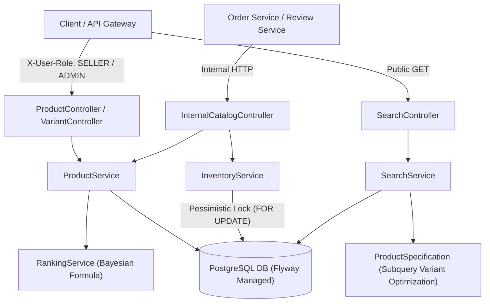
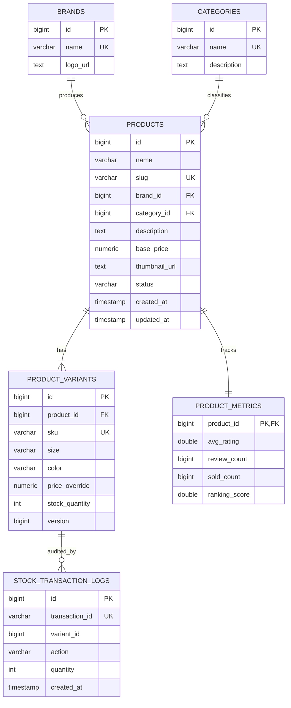

# StepStyle - Catalog & Search Microservice

Microservice quản lý danh mục giày, đồng bộ tồn kho với cơ chế Pessimistic Locking + Idempotency chặt chẽ, và công cụ tìm kiếm lọc đa tiêu chí ưu tiên hiển thị theo thuật toán **Bayesian Rating & Popularity Ranking**.

---

## 1. Kiến trúc hệ thống & Sơ đồ dữ liệu (ERD)

### Sơ đồ kiến trúc xử lý (Architecture Flow)



### Sơ đồ quan hệ thực thể (ERD)



---

## 2. Công thức tính điểm ưu tiên (Bayesian Ranking Formula)

Thuật toán ranking kết hợp giữa điểm đánh giá Bayesian (tránh thiên lệch cho sản phẩm ít lượt đánh giá) và hàm logarithm tăng trưởng cho lượt bán & đánh giá:

$$\text{weightedRating} = \frac{\text{reviewCount} \cdot \text{avgRating} + m \cdot C}{\text{reviewCount} + m}$$

$$\text{rankingScore} = w_1 \cdot \text{weightedRating} + w_2 \cdot \ln(1 + \text{soldCount}) + w_3 \cdot \ln(1 + \text{reviewCount})$$

- $C$ (`priorMean`): Giá trị rating trung bình toàn hệ thống (mặc định: `3.5`).
- $m$ (`minReviews`): Ngưỡng số lượng review để kéo rating về mức trung bình $C$ nếu sản phẩm có quá ít đánh giá (mặc định: `10.0`).
- $w_1 = 2.0$: Trọng số điểm đánh giá chất lượng.
- $w_2 = 1.5$: Trọng số doanh số bán hàng.
- $w_3 = 1.0$: Trọng số độ tin cậy từ số lượng phản hồi.

---

## 3. Hướng dẫn khởi chạy

### A. Chạy bằng Docker Compose (Khuyến nghị)
Hệ thống đi kèm cấu hình tự động khởi tạo PostgreSQL và service:

```bash
# Build và khởi chạy PostgreSQL + Catalog Service
docker compose up --build -d

# Xem log khởi chạy
docker compose logs -f catalog-service
```
- Endpoint Swagger UI: [http://localhost:8083/swagger-ui.html](http://localhost:8083/swagger-ui.html)
- Endpoint OpenAPI JSON: [http://localhost:8083/v3/api-docs](http://localhost:8083/v3/api-docs)

### B. Chạy trực tiếp trên máy cục bộ (Local Maven)

1. Đảm bảo bạn đã cài **JDK 17** và có PostgreSQL đang chạy trên cổng 5432 (database: `stepstyle_catalog`).
2. Chạy ứng dụng:
   ```bash
   mvn clean spring-boot:run
   ```
3. Chạy toàn bộ Unit Tests & Concurrency Tests (dùng H2 in-memory mode offline, không cần DB thật):
   ```bash
   mvn test
   ```

---

## 4. Danh sách API Endpoints

| Phương thức | Đường dẫn API | Header bắt buộc | Mô tả |
| :--- | :--- | :--- | :--- |
| `POST` | `/api/v1/products` | `X-User-Role: SELLER` hoặc `ADMIN` | Tạo sản phẩm mới kèm danh sách biến thể size/màu |
| `PUT` | `/api/v1/products/{id}` | `X-User-Role: SELLER` hoặc `ADMIN` | Cập nhật thông tin cơ bản của sản phẩm |
| `DELETE` | `/api/v1/products/{id}` | `X-User-Role: SELLER` hoặc `ADMIN` | Xóa mềm sản phẩm (`status = DELETED`) |
| `GET` | `/api/v1/products/{id}` | *Không (Public)* | Chi tiết sản phẩm, danh sách biến thể và metrics |
| `POST` | `/api/v1/products/{id}/variants` | `X-User-Role: SELLER` hoặc `ADMIN` | Thêm biến thể mới cho sản phẩm có sẵn |
| `GET` | `/api/v1/products/search` | *Không (Public)* | Tìm kiếm lọc theo keyword, brand, category, size, color, giá, còn hàng; sắp xếp theo rankingScore |
| `POST` | `/api/v1/internal/inventory/adjust` | *Không (Internal)* | Điều chỉnh tồn kho (`RESERVE`, `RELEASE`, `DEDUCT`) với Pessimistic Lock & Idempotent Replay |
| `POST` | `/api/v1/internal/products/{id}/metrics` | *Không (Internal)* | Cập nhật rating, số bán, review và tự động tính lại rankingScore |

---

## 5. Ví dụ kiểm thử bằng `curl`

### 1. Tạo mới một đôi giày (Yêu cầu quyền SELLER)
```bash
curl -X POST http://localhost:8083/api/v1/products \
  -H "Content-Type: application/json" \
  -H "X-User-Role: SELLER" \
  -d '{
    "name": "Nike Air Zoom Pegasus 41",
    "brandId": 1,
    "categoryId": 1,
    "description": "Responsive road running shoe with upgraded ReactX foam cushioning.",
    "basePrice": 140.00,
    "thumbnailUrl": "https://images.stepstyle.com/pegasus-41.jpg",
    "variants": [
      {
        "sku": "NK-PEG41-WHT-41",
        "size": "41",
        "color": "White",
        "priceOverride": null,
        "stockQuantity": 50
      },
      {
        "sku": "NK-PEG41-WHT-42",
        "size": "42",
        "color": "White",
        "priceOverride": null,
        "stockQuantity": 60
      }
    ]
  }'
```

### 2. Thêm biến thể mới cho sản phẩm
```bash
curl -X POST http://localhost:8083/api/v1/products/1/variants \
  -H "Content-Type: application/json" \
  -H "X-User-Role: ADMIN" \
  -d '{
    "sku": "NK-PEG40-RED-43",
    "size": "43",
    "color": "Solar Red",
    "priceOverride": 145.00,
    "stockQuantity": 25
  }'
```

### 3. Tìm kiếm sản phẩm theo bộ lọc & Sắp xếp ưu tiên (Bayesian Ranking)
```bash
# Lọc giày size 42, màu White, khoảng giá từ 100 đến 150, chỉ lấy sản phẩm còn hàng, sắp xếp theo ranking
curl -X GET "http://localhost:8083/api/v1/products/search?size=42&color=White&minPrice=100&maxPrice=150&inStockOnly=true&sortBy=rankingScore,desc&page=0&sizePerPage=10"
```

### 4. Điều chỉnh tồn kho với Idempotency (Trừ kho an toàn)
```bash
curl -X POST http://localhost:8083/api/v1/internal/inventory/adjust \
  -H "Content-Type: application/json" \
  -d '{
    "transactionId": "order-tx-99881122",
    "variantId": 1,
    "quantity": 2,
    "action": "DEDUCT"
  }'
```
> **Lưu ý:** Gửi lại cùng `transactionId` trên sẽ nhận được phản hồi ngay lập tức với `"idempotentReplay": true`, kho không bị trừ hai lần.

### 5. Cập nhật chỉ số Review & Doanh số (Từ Review/Order Service)
```bash
curl -X POST http://localhost:8083/api/v1/internal/products/1/metrics \
  -H "Content-Type: application/json" \
  -d '{
    "newAvgRating": 4.75,
    "reviewCountDelta": 15,
    "soldCountDelta": 50
  }'
```
